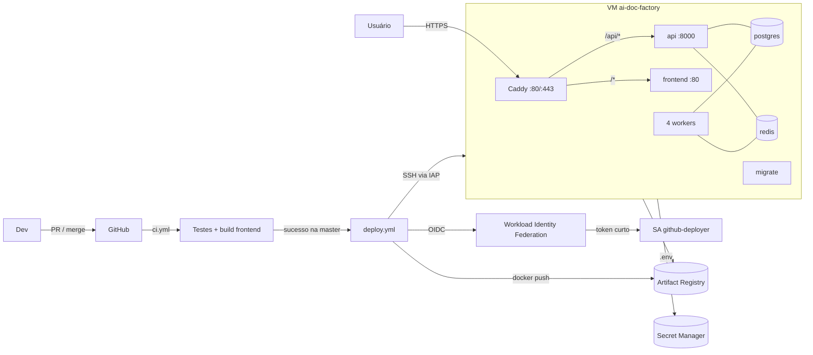

# Deploy no GCP: Document AI Factory

Documentação de ponta a ponta da infraestrutura no Google Cloud: o que foi construído, por que foi construído assim, a responsabilidade de cada arquivo e configuração, e o passo a passo para subir tudo do zero (projeto, Terraform, CI/CD, deploy e liberação de acesso).

## Sumário

1. [Visão geral](#1-visão-geral)
2. [Arquitetura](#2-arquitetura)
3. [Decisões de projeto](#3-decisões-de-projeto)
4. [Estrutura de arquivos](#4-estrutura-de-arquivos)
5. [Terraform: o que cada parte faz](#5-terraform-o-que-cada-parte-faz)
6. [Bootstrap da VM e `deploy.sh`](#6-bootstrap-da-vm-e-deploysh)
7. [Pipelines de CI e CD](#7-pipelines-de-ci-e-cd)
8. [Variáveis e segredos](#8-variáveis-e-segredos)
9. [Identidades e permissões (IAM)](#9-identidades-e-permissões-iam)
10. [Custos](#10-custos)
11. [Passo a passo do zero](#11-passo-a-passo-do-zero)
12. [Liberação de acesso](#12-liberação-de-acesso)
13. [Operação do dia a dia](#13-operação-do-dia-a-dia)
14. [Solução de problemas](#14-solução-de-problemas)
15. [Limitações conhecidas](#15-limitações-conhecidas)
16. [Remover tudo](#16-remover-tudo)

---

## 1. Visão geral

| Item | Escolha |
|---|---|
| Execução | 1 VM Compute Engine (`e2-medium`, Ubuntu 24.04) rodando o `docker-compose.yml` do repositório |
| Entrada HTTP | Caddy na própria VM, com HTTPS automático (Let's Encrypt) |
| Domínio | `<ip-com-hífens>.sslip.io` por padrão; domínio próprio opcional |
| Imagens | Artifact Registry (`api` e `frontend`), com tag = SHA do commit |
| Segredos da aplicação | Secret Manager (um segredo com o conteúdo do `.env`) |
| IaC | Terraform modular, valores em `terraform.tfvars`, estado em bucket GCS |
| CI | GitHub Actions `ci`: testes do backend, lint e build do frontend |
| CD | GitHub Actions `deploy`: build, push e deploy via SSH pelo IAP |
| Autenticação CI → GCP | Workload Identity Federation (OIDC), sem chave JSON |
| Backup | Snapshot diário do disco, retenção de 7 dias |

Nada do código da aplicação foi alterado. A infraestrutura usa o `docker-compose.yml` existente e aplica por cima um arquivo de override, gerado na VM.

## 2. Arquitetura



Fluxo de uma entrega:

1. Um PR roda o `ci`.
2. O merge na `master` roda o `ci` de novo; se passar, o `deploy` dispara para o mesmo SHA.
3. O `deploy` autentica no GCP por WIF, faz o build e o push de `api:<sha>` e `frontend:<sha>`.
4. O `deploy` entra na VM por SSH (túnel IAP) e executa `deploy.sh <sha>`.
5. O `deploy.sh` atualiza o repositório na VM para o SHA, baixa o `.env` do Secret Manager, faz `docker compose pull` e `up -d`.
6. O serviço `migrate` aplica as migrações e cria o primeiro admin; depois sobem a `api`, os workers e o `frontend`.
7. O `deploy` faz um smoke test em `https://<domínio>/api/health`.

## 3. Decisões de projeto

**VM com Docker Compose, não Cloud Run/GKE.**
- A API e os 4 workers compartilham o disco `/data` (PDF original e PNGs das páginas). No Cloud Run isso exigiria mudar o código para usar Cloud Storage.
- Os workers são loops longos consumindo Redis, sem HTTP, o que não combina com o modelo do Cloud Run.
- Memorystore (Redis gerenciado) custa ~US$ 35/mês e Cloud SQL ~US$ 10/mês no mínimo. Isso consumiria o crédito do trial rapidamente.
- O `docker-compose.yml` já é o ambiente testado do projeto. Reaproveitá-lo evita divergência entre local e produção.

**Build no CI, não na VM.** A VM só baixa imagens prontas. O build fica reproduzível, a VM não gasta CPU e memória compilando, e o rollback é só trocar a tag.

**Caddy com sslip.io.** HTTPS sem comprar domínio e sem Load Balancer, que custaria ~US$ 18/mês. O Caddy remove o prefixo `/api` antes de repassar à API, e o frontend é compilado com `VITE_API_PREFIX=/api`. Com isso, frontend e API ficam na mesma origem.

**WIF em vez de chave de service account.** Nenhuma credencial fica guardada no GitHub. O provider só aceita tokens do repositório configurado e da branch de deploy.

**SSH via IAP.** A porta 22 só aceita o range do IAP (`35.235.240.0/20`). O acesso é controlado por IAM (OS Login), sem chaves SSH manuais.

**Um segredo com o `.env` inteiro.** É simples: um comando para atualizar e cabe na cota gratuita. O Terraform cria só o segredo vazio, e o valor é enviado com `gcloud`, para nunca passar pelo tfstate.

**Terraform modular com `terraform.tfvars`.** Cada módulo tem uma responsabilidade. O ambiente `envs/prod` só faz a composição. Todos os valores ficam no `terraform.tfvars`, versionado e sem segredos. Outro ambiente seria `envs/<nome>` com o próprio `.tfvars`.

**Override do compose gerado na VM.** O `docker-compose.gcp.yml` troca `build` por `image`, remove as portas publicadas da `api` e do `frontend` e adiciona o `caddy`. Ele é gerado pelo bootstrap, então não precisa existir no repositório.

### Validações feitas

| Validação | Resultado |
|---|---|
| `terraform fmt -recursive -check` | OK |
| `terraform validate` em `envs/prod` | OK |
| Renderização do `startup.sh.tftpl` (com e sem `acme_email`) + `bash -n` do script e do `deploy.sh` | OK |
| `docker compose config` com o override | OK: nenhum `build` restante; só o `caddy` publica portas |
| `npm run build` do frontend com `VITE_API_URL`/`VITE_API_PREFIX` de produção | OK |
| `npm run lint` | 4 erros que já existiam no código; no CI o passo é não bloqueante |
| `terraform apply`, autenticação WIF, SSH pelo IAP no CI, testes do backend no Actions | Não executados: só são validados no primeiro deploy real |

## 4. Estrutura de arquivos

```
.github/workflows/
  ci.yml                       CI: testes e build
  deploy.yml                   CD: build, push e deploy
infra/gcp/
  README.md                    este documento
  envs/prod/
    versions.tf                versão do Terraform, provider e backend GCS
    main.tf                    APIs, SA da VM e composição dos módulos
    variables.tf               declaração das variáveis (sem defaults)
    terraform.tfvars           valores do ambiente (carregado automaticamente; versionado, sem segredos)
    outputs.tf                 URL, IP, SSH e variáveis do GitHub
    backend.hcl.example        modelo da config do bucket de estado
    .terraform.lock.hcl        versões travadas dos providers
  modules/
    network/                   IP fixo e firewall
    secrets/                   segredo do .env e quem pode ler
    artifact_registry/         repositório Docker e limpeza
    github_wif/                pool/provider OIDC e SA de deploy
    compute/                   VM, bootstrap e snapshots
      templates/startup.sh.tftpl
```

Arquivos ignorados pelo git: `.terraform/`, `*.tfstate*`, `*.local.tfvars`, `backend.hcl`, `.env` e `.env.*` (exceto `.env.example`).

## 5. Terraform: o que cada parte faz

### 5.1 `envs/prod`

| Arquivo | Responsabilidade |
|---|---|
| `versions.tf` | Exige Terraform >= 1.5 e provider `google ~> 6.0`. Backend `gcs` com `prefix = ai-doc-factory/prod`; o bucket vem do `backend.hcl`. `user_project_override`/`billing_project` cobram a cota no próprio projeto, exigido por algumas APIs quando se usa credencial de usuário. |
| `main.tf` | Habilita as APIs, cria a SA da VM (`<name>-vm`) com permissão de escrever logs e métricas, calcula o domínio (`var.domain` ou `<ip>.sslip.io`) e instancia os módulos. |
| `variables.tf` | Só tipos, sem valores padrão: tudo vem do `terraform.tfvars`. |
| `terraform.tfvars` | Valores do ambiente (ver 8.1). |
| `outputs.tf` | `url`, `ip`, `secret_id`, `ssh` (comando pronto) e `github_variables` (mapa para o GitHub). |

APIs habilitadas pelo `main.tf`:

| API | Para quê |
|---|---|
| `compute` | VM, disco, IP, firewall, snapshots |
| `secretmanager` | Segredo do `.env` |
| `artifactregistry` | Imagens Docker |
| `iam`, `iamcredentials`, `sts` | Service accounts e troca de token do WIF |
| `iap` | Túnel SSH |
| `oslogin` | Login SSH controlado por IAM |
| `cloudresourcemanager` | Leitura do projeto e bindings de IAM |

### 5.2 `modules/network`

| Recurso | Função |
|---|---|
| `google_compute_address.this` | IP externo fixo (`<name>-ip`). Fixo para o domínio sslip.io não mudar quando a VM reinicia. |
| `google_compute_firewall.web` | Libera 80 e 443 de qualquer origem para VMs com a tag `<name>`. O Let's Encrypt precisa alcançar essas portas. |
| `google_compute_firewall.ssh` | Libera a 22 só para `ssh_source_ranges` (padrão: range do IAP). |

Entradas: `name`, `region`, `network` (padrão `default`), `ssh_source_ranges`. Saídas: `address`, `network`, `tag`.

### 5.3 `modules/secrets`

| Recurso | Função |
|---|---|
| `google_secret_manager_secret.this` | Cria o segredo `<name>-env`, só o contêiner, sem valor. |
| `google_secret_manager_secret_iam_member.accessors` | Dá `secretAccessor` a cada membro do mapa `accessors` (aqui, só a SA da VM). |

O mapa usa chaves fixas (`vm = ...`) porque o e-mail da SA só é conhecido após o apply, e o `for_each` exige chaves conhecidas no plan.

### 5.4 `modules/artifact_registry`

| Recurso | Função |
|---|---|
| `google_artifact_registry_repository.this` | Repositório Docker `<name>` na região. |
| Políticas de limpeza | `keep-recent`: mantém as 5 versões mais novas. `delete-old`: apaga as mais velhas que 7 dias. O KEEP prevalece, então sempre há pelo menos 5 versões para rollback. |
| `..._iam_member.readers` | `artifactregistry.reader` para a SA da VM. |
| `..._iam_member.writers` | `artifactregistry.writer` para a SA de deploy. |

Saídas: `host` (`<região>-docker.pkg.dev`) e `url` (`<host>/<projeto>/<repo>`).

### 5.5 `modules/github_wif`

| Recurso | Função |
|---|---|
| `google_iam_workload_identity_pool.this` | Pool `github`. |
| `google_iam_workload_identity_pool_provider.github` | Provider OIDC do GitHub (`token.actions.githubusercontent.com`). Mapeia `sub`, `repository` e `ref`. **Condição:** `repository == <github_repository>` e `ref` em `allowed_refs` (padrão `refs/heads/master`). Qualquer outro repositório ou branch é recusado. |
| `google_service_account.deployer` | SA `github-deployer`, a identidade do pipeline. |
| `google_service_account_iam_member.wif` | `workloadIdentityUser`: o repositório pode se passar pela SA de deploy. |
| `google_project_iam_member.deployer` | Papéis no projeto: `compute.viewer`, `compute.osAdminLogin` (SSH com sudo) e `iap.tunnelResourceAccessor`. |
| `google_service_account_iam_member.act_as` | `serviceAccountUser` na SA da VM, exigido para SSH com OS Login numa VM que roda com outra SA. |

Saídas: `provider_name`, `service_account_email`, `member`.

### 5.6 `modules/compute`

| Recurso | Função |
|---|---|
| `google_compute_instance.this` | VM Ubuntu 24.04, disco `pd-balanced`, IP fixo, tag de firewall, SA da VM com escopo `cloud-platform` (o acesso real é limitado pelo IAM), Secure Boot e OS Login ligados. `allow_stopping_for_update` permite trocar o `machine_type` desligando a VM. O script de bootstrap vai em `metadata.startup-script`: alterá-lo atualiza a VM sem recriá-la. A imagem é ignorada em mudanças para a VM não ser recriada quando sair uma imagem nova. |
| `google_compute_resource_policy.snapshots` | Agenda diária às 06:00 UTC, retenção de 7 dias; mantém os snapshots se o disco for apagado. |
| `google_compute_disk_resource_policy_attachment.snapshots` | Liga a agenda ao disco de boot. |

Variáveis do template: `repo_url`, `secret_id`, `domain`, `acme_email`, `registry_host`, `registry_url`.

## 6. Bootstrap da VM e `deploy.sh`

### 6.1 `startup.sh.tftpl`

Roda **a cada boot** e é idempotente:

1. Cria e ativa um swap de 2 GB (margem para os picos do OCR na e2-medium).
2. Instala o Docker e o plugin compose (`get.docker.com`) se não existirem.
3. Clona o repositório em `/opt/ai-doc-factory/app` se ainda não existir.
4. Grava `/opt/ai-doc-factory/Caddyfile`.
5. Grava `/opt/ai-doc-factory/docker-compose.gcp.yml`.
6. Grava `/opt/ai-doc-factory/deploy.sh`.

O bootstrap **não sobe a aplicação**. Ela só sobe no primeiro deploy, porque é ele que define qual imagem usar. Depois disso, o Docker religa os containers sozinho a cada boot (`restart: unless-stopped`).

### 6.2 Arquivos na VM

| Caminho | Conteúdo |
|---|---|
| `/opt/ai-doc-factory/app/` | Checkout do repositório no SHA implantado (usado pelo `docker-compose.yml`) |
| `/opt/ai-doc-factory/app/.env` | `.env` baixado do Secret Manager + `CORS_ORIGINS` + `IMAGE_TAG` (permissão 600) |
| `/opt/ai-doc-factory/Caddyfile` | Domínio, gzip, `/api/*` → `api:8000` sem o prefixo, resto → `frontend:80` |
| `/opt/ai-doc-factory/docker-compose.gcp.yml` | Override: `image` no lugar de `build`, sem portas na `api`/`frontend`, serviço `caddy` |
| `/opt/ai-doc-factory/deploy.sh` | Script de deploy |
| `/opt/ai-doc-factory/IMAGE_TAG` | SHA atualmente no ar |

### 6.3 `deploy.sh <sha>`

1. Obtém um token de acesso e o ID do projeto pelo metadata server (a identidade é a SA da VM).
2. `git fetch` + `checkout` do SHA, para o `docker-compose.yml` ficar igual ao da imagem.
3. Lê a última versão do segredo `<name>-env`, remove `CORS_ORIGINS`/`IMAGE_TAG` e grava o `.env`.
4. Acrescenta `CORS_ORIGINS=https://<domínio>` e `IMAGE_TAG=<sha>`.
5. `docker login` no Artifact Registry com o token.
6. `docker compose pull` e `up -d --remove-orphans` com o override.
7. Registra o SHA em `IMAGE_TAG` e remove imagens com mais de 7 dias.

O mesmo script serve para deploy, redeploy e rollback.

## 7. Pipelines de CI e CD

### 7.1 `ci` (`.github/workflows/ci.yml`)

Gatilhos: `pull_request` e `push` na `master`. Sem acesso ao GCP (`contents: read`). PRs novos cancelam execuções antigas do mesmo PR.

| Job | Passos |
|---|---|
| `backend` | Sobe `postgres:16` e `redis:7` como services; instala Tesseract (`por`) e Poppler; Python 3.12; `pip install`; `alembic upgrade head`; `pytest tests -q` com `CLASSIFICADOR=regras` (sem rede). |
| `frontend` | Node 22; `npm ci`; `npm run lint` (não bloqueante até os 4 erros atuais serem corrigidos); `npm run build`. |

### 7.2 `deploy` (`.github/workflows/deploy.yml`)

Gatilhos:
- `workflow_run`: quando o `ci` termina na `master`. Só segue se a conclusão for `success`.
- `workflow_dispatch`: manual.

O SHA implantado é `workflow_run.head_sha` (exatamente o commit testado) ou `github.sha` no disparo manual. Concorrência `deploy-production`: um deploy por vez, sem cancelar o que já está rodando.

| Job | Passos |
|---|---|
| `build` | Checkout do SHA; autenticação WIF; `gcloud auth configure-docker`; Buildx com cache do GitHub; push de `api:<sha>` (raiz) e `frontend:<sha>` (`frontend/`, com `VITE_API_URL=$APP_URL` e `VITE_API_PREFIX=/api`). |
| `deploy` | Environment `production`; autenticação WIF; `gcloud compute ssh --tunnel-through-iap` executando `sudo /opt/ai-doc-factory/deploy.sh <sha>`; `curl` com até 20 tentativas em `$APP_URL/api/health`. |

O `workflow_run` só funciona depois que o `deploy.yml` estiver na `master`.

## 8. Variáveis e segredos

| Tipo | Onde | Versionado | Quem lê |
|---|---|---|---|
| Configuração da infra | `envs/prod/terraform.tfvars` | Sim | Terraform |
| Bucket do estado | `envs/prod/backend.hcl` | Não | `terraform init` |
| `.env` da aplicação | Secret Manager `<name>-env` | Não | VM (`deploy.sh`) |
| Configuração do CI/CD | GitHub → Settings → Secrets and variables → **Variables** | Não | `deploy.yml` |

Não há **GitHub Secrets**: com WIF, nenhuma credencial fica no GitHub.

### 8.1 `terraform.tfvars`

| Variável | Padrão no arquivo | Responsável por |
|---|---|---|
| `project_id` | `PREENCHER` | Projeto onde tudo é criado |
| `region` / `zone` | `us-central1` / `us-central1-a` | Localização. São Paulo (`southamerica-east1`) custa ~50% a mais |
| `name` | `ai-doc-factory` | Prefixo de VM, IP, SA, firewall, segredo e registry |
| `machine_type` | `e2-medium` | Tamanho da VM. `e2-standard-2` (8 GB) se o OCR faltar memória |
| `disk_size_gb` | `30` | Disco de boot: imagens, Postgres, lotes e cache de LLM |
| `repo_url` | repositório original | O que a VM clona (só para o `docker-compose.yml`) |
| `github_repository` | `EmmanuelBMoraes/ai-doc-factory` | Único repositório aceito pelo WIF |
| `deploy_branch` | `master` | Única branch aceita pelo WIF |
| `domain` | `""` | Domínio próprio. Vazio usa `<ip>.sslip.io` |
| `acme_email` | `""` | E-mail de avisos do Let's Encrypt |
| `ssh_source_ranges` | `["35.235.240.0/20"]` | Origens com SSH (padrão: só IAP) |
| `enable_snapshots` | `true` | Snapshot diário do disco |

O `terraform.tfvars` é carregado automaticamente por `plan`/`apply`/`destroy`, sem `-var-file`. Para valores só seus, sem versionar, crie um `*.local.tfvars` e passe `-var-file=<arquivo>`; ele sobrescreve o `terraform.tfvars`.

### 8.2 Variáveis do GitHub

Vêm de `terraform output github_variables`:

| Variável | Uso |
|---|---|
| `GCP_PROJECT_ID` | Projeto do SSH |
| `GCP_ZONE` | Zona da VM |
| `GCP_VM_NAME` | Nome da VM |
| `GCP_REGISTRY` | Destino das imagens (`<região>-docker.pkg.dev/<projeto>/<repo>`) |
| `GCP_WIF_PROVIDER` | Provider do WIF (`projects/<nº>/locations/global/workloadIdentityPools/github/providers/github`) |
| `GCP_DEPLOY_SA` | SA usada pelo pipeline |
| `APP_URL` | URL pública: compilada no frontend e usada no smoke test |

### 8.3 `.env` da aplicação (conteúdo do segredo)

| Variável | Obrigatória | Observação |
|---|---|---|
| `POSTGRES_USER` / `POSTGRES_DB` | Não (padrão `docfactory`) | |
| `POSTGRES_PASSWORD` | **Sim** | Só vale na criação do volume; ver 13.3 para trocar |
| `AUTH_SEGREDO` | **Sim** | Assina o JWT. Sem ele, o login responde 503 |
| `AUTH_USUARIO` / `AUTH_SENHA` | **Sim no 1º deploy** | Criam o primeiro admin; depois não têm efeito |
| `AUTH_EXPIRA_MIN` | Não (480) | Validade do token |
| `CLASSIFICADOR` | Recomendado | `regras` (sem rede, sem custo) ou `jev` |
| `OPENROUTER_API_KEY`, `JEV_MODEL`, `GEMINI_API_KEY` | Se `jev` | Cobrança fora do GCP |
| `GEMINI_MODEL`, `GEMINI_ANALISE_MODEL` | Não | |
| `CONF_AUTO` / `CONF_MIN` | Não (0.85 / 0.50) | Limiares de roteamento |
| `CORS_ORIGINS`, `IMAGE_TAG` | **Não definir** | O `deploy.sh` calcula e sobrescreve |
| `API_PORT`, `FRONTEND_PORT`, `VITE_*` | Não se aplica | Portas não publicadas; `VITE_*` vem do build no CI |

## 9. Identidades e permissões (IAM)

| Identidade | Papéis | Para quê |
|---|---|---|
| `ai-doc-factory-vm@` (SA da VM) | `logging.logWriter`, `monitoring.metricWriter` (projeto); `secretAccessor` (só no segredo); `artifactregistry.reader` (só no repositório) | Ler o `.env` e baixar imagens |
| `github-deployer@` (SA do pipeline) | `compute.viewer`, `compute.osAdminLogin`, `iap.tunnelResourceAccessor` (projeto); `artifactregistry.writer` (só no repositório); `serviceAccountUser` (só na SA da VM) | Enviar imagens e executar o deploy por SSH |
| `principalSet://.../attribute.repository/<owner>/<repo>` | `workloadIdentityUser` na SA do pipeline | Workflows do repositório, na branch de deploy, assumem a SA |
| Você (Owner do projeto) | Owner | Rodar o Terraform |

## 10. Custos

Preços de tabela em `us-central1`:

| Item | US$/mês |
|---|---|
| e2-medium 24×7 | ~24,50 |
| Disco pd-balanced 30 GB | ~3,00 |
| IP fixo em uso | ~3,65 |
| Snapshots | ~0,50–1,00 |
| Artifact Registry | ~0,10–0,20 |
| Secret Manager, IAP, OS Login, Logging | 0 (cota gratuita) |
| **Total** | **~US$ 32–33** (~US$ 1,08/dia) |

O trial dura **90 dias**, independentemente do saldo. Com crédito de US$ 300, a configuração atual gasta ~US$ 100 no período. Com saldo de R$ 300, dura ~50 dias (câmbio entre R$ 5,00 e R$ 6,00). Para economizar: VM Spot (~US$ 14/mês) ou desligar fora do horário (desligada, ainda paga disco e IP, ~US$ 10/mês). OpenRouter e Gemini são cobrados fora do GCP.

---

## 11. Passo a passo do zero

Os comandos são para bash (Linux, macOS, WSL ou Git Bash). Execute a partir da raiz do repositório.

### 11.0 Ferramentas

| Ferramenta | Versão | Verificar |
|---|---|---|
| Google Cloud CLI | recente | `gcloud version` |
| Terraform | >= 1.5 | `terraform version` |
| GitHub CLI | recente | `gh --version` |
| jq, openssl, python3 | qualquer | `jq --version` |

### 11.1 Conta e trial

1. Acesse <https://console.cloud.google.com/freetrial> com a conta Google que vai pagar.
2. Ative o trial: cadastre o cartão (não há cobrança automática; ao fim do trial é preciso ativar a conta paga).
3. Anote a conta de faturamento:

```bash
gcloud auth login
gcloud billing accounts list
# ACCOUNT_ID            NAME                      OPEN
# 0X0X0X-0X0X0X-0X0X0X  Minha conta de faturamento  True
```

### 11.2 Projeto

Use um projeto **exclusivo** e uma configuração do gcloud separada, para não aplicar nada por engano em outro projeto.

```bash
export PROJECT_ID="ai-doc-factory-$(openssl rand -hex 3)"   # único globalmente, 6–30 caracteres
export BILLING_ID="0X0X0X-0X0X0X-0X0X0X"
export REGION="us-central1"

gcloud config configurations create ai-doc-factory
gcloud config set account "$(gcloud auth list --filter=status:ACTIVE --format='value(account)')"
gcloud projects create "$PROJECT_ID" --name="AI Doc Factory"
gcloud config set project "$PROJECT_ID"
gcloud billing projects link "$PROJECT_ID" --billing-account="$BILLING_ID"

# APIs mínimas para o Terraform começar (o resto ele habilita)
gcloud services enable serviceusage.googleapis.com cloudresourcemanager.googleapis.com storage.googleapis.com
```

### 11.3 Credencial para o Terraform

```bash
gcloud auth application-default login
gcloud auth application-default set-quota-project "$PROJECT_ID"
```

### 11.4 Bucket do estado

```bash
gcloud storage buckets create "gs://${PROJECT_ID}-tfstate" \
  --location="$REGION" --uniform-bucket-level-access
gcloud storage buckets update "gs://${PROJECT_ID}-tfstate" --versioning
```

### 11.5 Configurar o ambiente

```bash
cd infra/gcp/envs/prod
echo "bucket = \"${PROJECT_ID}-tfstate\"" > backend.hcl
```

Edite `terraform.tfvars`:

```hcl
project_id = "<PROJECT_ID>"

# Se usar um fork, troque os dois:
repo_url          = "https://github.com/<owner>/ai-doc-factory.git"
github_repository = "<owner>/ai-doc-factory"
```

### 11.6 Aplicar o Terraform

```bash
terraform init -backend-config=backend.hcl
terraform plan -out=tfplan
terraform apply tfplan
terraform output
```

Saída esperada:

```
github_variables = { APP_URL = "https://34-123-45-67.sslip.io", GCP_DEPLOY_SA = "github-deployer@...", ... }
ip        = "34.123.45.67"
secret_id = "ai-doc-factory-env"
ssh       = "gcloud compute ssh ai-doc-factory --zone us-central1-a --project ... --tunnel-through-iap"
url       = "https://34-123-45-67.sslip.io"
```

Conferir o bootstrap da VM (leva ~2–3 minutos depois do apply):

```bash
$(terraform output -raw ssh) -- 'sudo journalctl -u google-startup-scripts --no-pager | tail -20; ls /opt/ai-doc-factory'
# deve listar: Caddyfile  app  deploy.sh  docker-compose.gcp.yml
```

Na primeira conexão o gcloud gera uma chave SSH local e a registra no OS Login.

### 11.7 Criar o `.env` de produção e enviar ao Secret Manager

Crie o arquivo **fora do repositório**:

```bash
ENV_FILE="$HOME/ai-doc-factory.env.prod"
umask 077
cat > "$ENV_FILE" <<EOF
POSTGRES_USER=docfactory
POSTGRES_DB=docfactory
POSTGRES_PASSWORD=$(openssl rand -hex 24)
AUTH_USUARIO=admin@suaempresa.com.br
AUTH_SENHA=$(openssl rand -base64 18)
AUTH_SEGREDO=$(python3 -c 'import secrets; print(secrets.token_urlsafe(48))')
AUTH_EXPIRA_MIN=480
CLASSIFICADOR=regras
CONF_AUTO=0.85
CONF_MIN=0.50
# Com CLASSIFICADOR=jev:
# OPENROUTER_API_KEY=
# JEV_MODEL=
# GEMINI_API_KEY=
# GEMINI_MODEL=gemini-3.5-flash
# GEMINI_ANALISE_MODEL=gemini-3.5-flash
EOF

gcloud secrets versions add "$(terraform output -raw secret_id)" --data-file="$ENV_FILE"
```

Guarde o `AUTH_SENHA` gerado (ex.: num gerenciador de senhas). Ele é a senha do primeiro login.

### 11.8 Configurar o GitHub

O usuário precisa ser admin do repositório. Num fork, ative o Actions na aba **Actions**.

```bash
gh auth login
REPO="<owner>/ai-doc-factory"

# Variáveis (não são segredos)
terraform output -json github_variables \
  | jq -r 'to_entries[] | "\(.key)\t\(.value)"' \
  | while IFS=$'\t' read -r k v; do gh variable set "$k" --body "$v" --repo "$REPO"; done
gh variable list --repo "$REPO"

# Environment usado pelo job de deploy
gh api -X PUT "repos/$REPO/environments/production" >/dev/null
```

Recomendado em **Settings**:
- **Branches → Branch protection rules → `master`**: exigir PR e o check `ci / backend` e `ci / frontend` antes do merge.
- **Environments → production → Required reviewers** (opcional): exige aprovação manual antes de cada deploy.

### 11.9 Levar as pipelines e a infra para a `master`

Os arquivos estão na branch `chore/infra-gcp`, sem commit. Quando decidir publicar:

```bash
cd "$(git rev-parse --show-toplevel)"
git add .github infra .gitignore
git diff --cached          # conferir que não há segredo
git commit -m "chore(infra): deploy no GCP com Terraform e CI/CD via WIF"
git push -u origin chore/infra-gcp
gh pr create --base master --fill
```

- No PR, o `ci` roda (backend e frontend).
- Após o merge, o `ci` roda na `master` e, se passar, o `deploy` dispara sozinho.

### 11.10 Primeiro deploy e verificação

```bash
gh run list --workflow deploy --limit 3
gh run watch            # acompanha a execução

URL=$(terraform -chdir=infra/gcp/envs/prod output -raw url)
curl -fsS "$URL/api/health"            # {"status":"ok"}
```

Se o merge já aconteceu e o `deploy` não disparou (por exemplo, o `deploy.yml` ainda não estava na `master`), rode-o manualmente:

```bash
gh workflow run deploy --ref master
```

Abra `$URL` no navegador e entre com `AUTH_USUARIO` / `AUTH_SENHA`. Pela API:

```bash
TOKEN=$(curl -fsS -X POST "$URL/api/auth/login" -H 'Content-Type: application/json' \
  -d '{"usuario":"admin@suaempresa.com.br","senha":"<AUTH_SENHA>"}' | jq -r .access_token)
curl -fsS -H "Authorization: Bearer $TOKEN" "$URL/api/auth/me"
curl -fsS -H "Authorization: Bearer $TOKEN" -F "arquivo=@lote.pdf" "$URL/api/lotes"
```

Pronto: a aplicação está no ar.

---

## 12. Liberação de acesso

### 12.1 Usuários da aplicação

- **Primeiro admin:** criado no primeiro deploy a partir de `AUTH_USUARIO`/`AUTH_SENHA`.
- **Outros usuários:** não há endpoint de cadastro. Use o mesmo comando idempotente de bootstrap dentro do container da API; ele cria um usuário `plataforma`/`admin` se o e-mail ainda não existir:

```bash
$(terraform -chdir=infra/gcp/envs/prod output -raw ssh)
# na VM:
cd /opt/ai-doc-factory/app
read -rp "E-mail: " U; read -rsp "Senha: " S; echo
sudo docker compose -f docker-compose.yml -f ../docker-compose.gcp.yml \
  exec -e AUTH_USUARIO="$U" -e AUTH_SENHA="$S" api python -m app.bootstrap_admin
unset S
```

- **Desativar um usuário** (vale na próxima requisição):

```bash
sudo docker compose -f docker-compose.yml -f ../docker-compose.gcp.yml \
  exec postgres psql -U docfactory -c "UPDATE usuario SET ativo = false WHERE email = 'pessoa@empresa.com.br';"
```

Hoje toda rota de dados exige nível `plataforma`; usuários `tomador`/`prestador` recebem 403.

### 12.2 Operadores no GCP (SSH, logs, deploy manual)

```bash
PESSOA="user:pessoa@empresa.com.br"
for ROLE in roles/compute.viewer roles/iap.tunnelResourceAccessor roles/compute.osAdminLogin; do
  gcloud projects add-iam-policy-binding "$PROJECT_ID" --member="$PESSOA" --role="$ROLE" --condition=None
done
gcloud iam service-accounts add-iam-policy-binding \
  "ai-doc-factory-vm@${PROJECT_ID}.iam.gserviceaccount.com" \
  --member="$PESSOA" --role=roles/iam.serviceAccountUser
```

- `compute.osAdminLogin` dá sudo, necessário para operar o Docker. Para acesso sem sudo, use `compute.osLogin` no lugar.
- Para quem só atualiza o `.env`: `roles/secretmanager.secretVersionAdder` no segredo.
- Remover acesso: os mesmos comandos com `remove-iam-policy-binding`.

### 12.3 Quem pode fazer deploy

- O WIF só aceita workflows do repositório configurado, rodando em `refs/heads/<deploy_branch>`.
- Na prática, pode fazer deploy quem consegue fazer merge na `master` ou disparar o workflow (permissão de escrita no repositório).
- Para controlar isso: proteção da `master` e **Required reviewers** no environment `production` (11.8).

### 12.4 Acesso pela internet

- As portas 80 e 443 ficam abertas para qualquer origem, e o acesso aos dados é protegido pelo login. Restringir por IP quebraria a emissão e a renovação do certificado (o Let's Encrypt precisa alcançar a VM). Para restringir, seria preciso trocar o desafio ACME para DNS ou colocar um Load Balancer com IAP na frente.
- Postgres, Redis e as portas 8000/5173 não ficam expostos.

### 12.5 Domínio próprio

1. Crie um registro `A` apontando `docs.suaempresa.com.br` para o IP (`terraform output ip`).
2. No `terraform.tfvars`: `domain = "docs.suaempresa.com.br"` e `acme_email = "..."`.
3. `terraform apply`.
4. Reaplique o bootstrap na VM: `sudo google_metadata_script_runner startup`.
5. Atualize a variável `APP_URL` no GitHub e rode `gh workflow run deploy --ref master` (o frontend precisa ser recompilado com a nova URL).

---

## 13. Operação do dia a dia

Na VM, defina um atalho:

```bash
cd /opt/ai-doc-factory/app
alias dc='sudo docker compose -f docker-compose.yml -f ../docker-compose.gcp.yml'
```

### 13.1 Deploy, redeploy e rollback

| Ação | Como |
|---|---|
| Deploy normal | Merge na `master` |
| Deploy manual do HEAD da `master` | `gh workflow run deploy --ref master` |
| Versão no ar | `cat /opt/ai-doc-factory/IMAGE_TAG` |
| Redeploy da mesma versão (ex.: após trocar o `.env`) | `sudo /opt/ai-doc-factory/deploy.sh $(cat /opt/ai-doc-factory/IMAGE_TAG)` |
| Rollback | `sudo /opt/ai-doc-factory/deploy.sh <sha-anterior>` (as 5 últimas versões ficam no registry) |
| Versões disponíveis | `gcloud artifacts docker tags list $REGION-docker.pkg.dev/$PROJECT_ID/ai-doc-factory/api` |

Um rollback que atravessa uma migração de banco não desfaz o schema. Nesse caso, rode o `alembic downgrade` antes.

### 13.2 Logs e estado

```bash
dc ps
dc logs -f api
dc logs -f worker_ocr_seg worker_classify
dc logs caddy                # certificado e acessos
free -h; df -h /             # memória e disco
```

Os logs dos containers ficam só na VM (não vão para o Cloud Logging).

### 13.3 Alterar variáveis do `.env`

```bash
gcloud secrets versions add ai-doc-factory-env --data-file="$HOME/ai-doc-factory.env.prod"
# depois, redeploy da mesma versão (13.1)

# limpar versões antigas (6 ativas são gratuitas)
gcloud secrets versions list ai-doc-factory-env
gcloud secrets versions destroy <n> --secret=ai-doc-factory-env
```

Cuidados:
- **`POSTGRES_PASSWORD`**: rode antes `dc exec postgres psql -U docfactory -c "ALTER USER docfactory PASSWORD '<nova>';"` e só depois atualize o segredo. Caso contrário, a API não conecta.
- **`AUTH_SEGREDO`**: trocar invalida todos os tokens.
- **`AUTH_SENHA`**: não altera usuário existente.

### 13.4 Backup e restauração

Snapshots automáticos: `gcloud compute snapshots list`.

Backup lógico do banco:

```bash
# na VM
dc exec -T postgres pg_dump -U docfactory docfactory | gzip > /tmp/docfactory.sql.gz
# na sua máquina
gcloud compute scp ai-doc-factory:/tmp/docfactory.sql.gz . --zone us-central1-a --tunnel-through-iap
```

Restaurar o disco a partir de um snapshot:

```bash
gcloud compute instances stop ai-doc-factory --zone us-central1-a
gcloud compute disks create ai-doc-factory-restore --source-snapshot=<snapshot> --zone us-central1-a --type pd-balanced
gcloud compute instances detach-disk ai-doc-factory --disk=ai-doc-factory --zone us-central1-a
gcloud compute instances attach-disk ai-doc-factory --disk=ai-doc-factory-restore --boot --zone us-central1-a
gcloud compute instances start ai-doc-factory --zone us-central1-a
```

Isso cria divergência com o Terraform (o nome do disco muda). Rode um `plan` antes do próximo `apply` e ajuste o estado.

### 13.5 Mudar a infraestrutura

```bash
cd infra/gcp/envs/prod
terraform plan -out=tfplan
terraform apply tfplan
```

- Alterar o `startup.sh.tftpl` atualiza o metadata sem recriar a VM. Para aplicar sem reiniciar, rode na VM: `sudo google_metadata_script_runner startup`.
- Mudar o `machine_type` desliga e religa a VM durante o apply (`allow_stopping_for_update`); a aplicação fica fora do ar por ~1–2 minutos.

### 13.6 Economizar

```bash
gcloud compute instances stop ai-doc-factory --zone us-central1-a    # para de pagar CPU/RAM
gcloud compute instances start ai-doc-factory --zone us-central1-a   # containers voltam sozinhos
```

## 14. Solução de problemas

| Sintoma | Causa provável | Ação |
|---|---|---|
| `deploy` falha no auth: `Permission 'iam.serviceAccounts.getAccessToken' denied` / `unauthorized_client` | Repositório ou branch diferente do configurado no WIF | Conferir `github_repository` e `deploy_branch` no `terraform.tfvars` |
| `deploy` falha no SSH: `Permission denied (publickey)` | Propagação do OS Login na primeira vez | Rodar o job de novo; conferir os papéis da SA de deploy |
| SSH: `failed to connect to backend` | Firewall do IAP ou VM desligada | `gcloud compute firewall-rules list`; `gcloud compute instances list` |
| `IMAGE_TAG` obrigatório ao rodar `docker compose` | O compose foi chamado antes de qualquer deploy | Rodar o `deploy` ao menos uma vez |
| Navegador não abre / erro de certificado | Caddy não obteve o certificado | `dc logs caddy`; conferir portas 80/443 e se o domínio resolve para o IP |
| Login responde 503 | `AUTH_SEGREDO` ausente | Atualizar o segredo e fazer redeploy |
| Login responde 401 com a senha certa | Admin não foi criado (`AUTH_USUARIO`/`AUTH_SENHA` vazios no 1º deploy) | Criar pelo comando de 12.1; `dc logs migrate` |
| Frontend chama URL errada | `APP_URL` incorreta no build | Corrigir a variável no GitHub e rodar `deploy` |
| Containers reiniciando, OCR lento | Falta de memória | `dmesg -T \| grep -i oom`; subir para `e2-standard-2` |
| Smoke test falha logo após o deploy | `migrate` ainda rodando | `dc ps`; `dc logs migrate` |
| Rede `default` não existe | Política da organização bloqueia a rede padrão | Criar a VPC `default` ou adaptar o módulo `network` |
| Recriar o WIF após `destroy` falha | Pool excluído fica reservado por 30 dias | Trocar `pool_id` no módulo |

## 15. Limitações conhecidas

- **Instância única:** sem alta disponibilidade. Reinício ou manutenção da VM derruba o serviço por alguns minutos.
- **`/api/docs` (Swagger) não funciona** atrás do prefixo `/api`: a página busca `/openapi.json` sem o prefixo. A correção é rodar a API com `--root-path /api` no override (não testada).
- **Lint do frontend não bloqueante** até os 4 erros existentes serem corrigidos.
- **sslip.io** é um serviço de terceiros. Para uso real, configure domínio próprio.
- **Segredos em texto puro na VM** (`.env` com permissão 600), visíveis no `docker inspect` e incluídos nos snapshots.
- **Logs só na VM**: não há envio ao Cloud Logging.
- **Configuração e segredos no mesmo segredo**: mudar um limiar também passa pelo Secret Manager.
- **Acesso de operadores via gcloud**, não via Terraform (12.2).
- **Validação real pendente**: `apply`, WIF e SSH via IAP no CI só são validados no primeiro deploy.

## 16. Remover tudo

Para encerrar a cobrança, a forma mais simples é excluir o projeto:

```bash
gcloud projects delete "$PROJECT_ID"
```

Ou só os recursos, mantendo o projeto:

```bash
cd infra/gcp/envs/prod
terraform destroy
gcloud storage rm -r "gs://${PROJECT_ID}-tfstate"
gcloud compute snapshots list --format='value(name)' | xargs -r gcloud compute snapshots delete --quiet
```

Os snapshots são mantidos quando o disco é apagado (`KEEP_AUTO_SNAPSHOTS`) e precisam ser removidos à parte. Depois, remova as variáveis do GitHub (`gh variable delete <nome>`).
